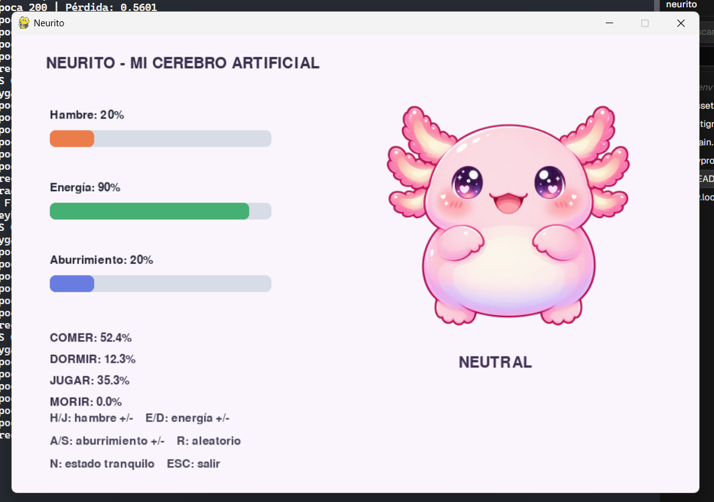
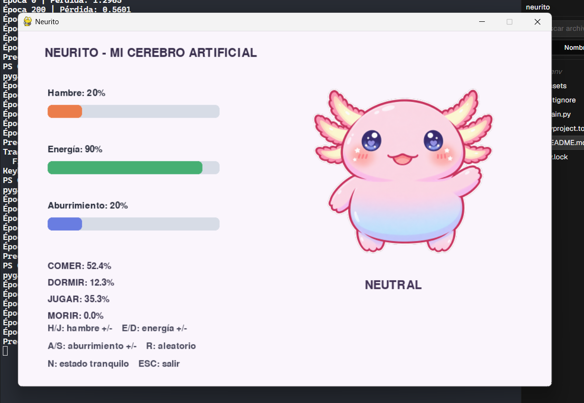
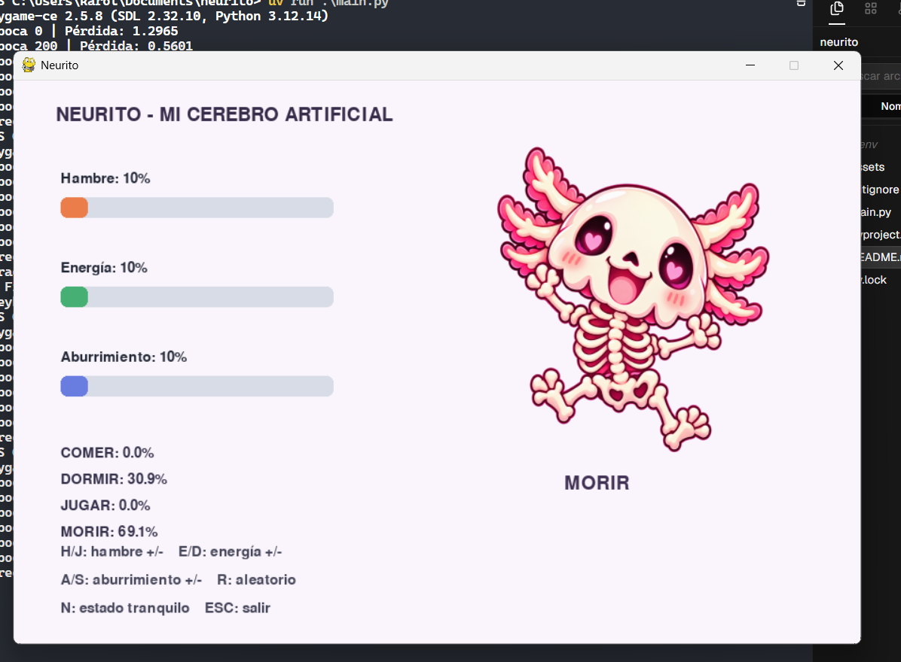

# Neurito

Neurito es una mascota que aprende a escoger una acción según tres valores: hambre, energía y aburrimiento. La red aprende cuatro acciones: comer, dormir, jugar y morir.

## Capturas

Estado neutral:

Otra imagen del estado neutral:

Estado de muerte aprendido por la red, con las tres necesidades en nivel crítico:

## ¿Cómo aprende la acción «morir»?

En `main.py`, `label_policy` asigna la etiqueta **morir** cuando hambre, energía y aburrimiento están en 15% o menos. Además de los 3000 ejemplos aleatorios, el entrenamiento agrega 300 ejemplos de esa zona crítica. Así la red ve suficientes casos para aprender la cuarta salida. La imagen `assets/morir.png` solo representa la acción; no se usa para entrenar.

Después del entrenamiento, el programa calcula las probabilidades de las cuatro acciones y muestra la de mayor probabilidad. No hay una regla que fuerce **morir** durante la ejecución. La red puede aproximar la regla y equivocarse en algunos valores, especialmente cerca del límite del 15%.

**Neutral** es una pose que ya tenía la interfaz. Se muestra en un estado tranquilo y no es una quinta acción de la red.

## Experimentos y preguntas

### Si mantengo dos necesidades fijas y cambio la tercera, ¿cuándo cambia la acción predicha?

Cambia cuando otra salida de la red supera a la que tenía la probabilidad más alta. Por ejemplo, al subir el hambre puede pasar de jugar a comer. En la zona crítica, las etiquetas de entrenamiento indican morir; como decide una red entrenada, el cambio puede no ocurrir exactamente en 15%.

### Si dos prioridades son casi iguales, ¿cómo cambian las salidas de Softmax?

Las probabilidades de esas acciones suelen quedar próximas. Si una salida aumenta, su porcentaje sube y los demás bajan; entre todas suman 100%. Son estimaciones de la red, no certezas.

### ¿Qué pasa si cambio la capa oculta de 6 a 3, 10 o 20 neuronas?

Con 3 neuronas la red tiene menos capacidad y podría aprender peor. Con 10 o 20 tiene más capacidad, aunque eso no garantiza una mejora. Compara la pérdida y la precisión impresas por el programa; no hay un resultado único sin ejecutar cada variante.

### ¿Qué pasa si cambio las épocas o la tasa de aprendizaje?

Con pocas épocas, el aprendizaje puede quedar incompleto. Más épocas pueden ayudar mientras la pérdida baje. Una tasa pequeña aprende despacio; una tasa demasiado alta puede hacer que la pérdida oscile o aumente. La configuración actual usa 1200 épocas y una tasa de 0.1.

### ¿Qué datos y etiquetas hacen falta para una cuarta acción?

Hace falta definir cuándo corresponde y dar al modelo ejemplos de esa situación con su etiqueta. Aquí se reutilizan hambre, energía y aburrimiento: los casos en que las tres son 15% o menos reciben la etiqueta **morir**, y se agregan 300 ejemplos críticos al entrenamiento. Por eso no hace falta una entrada nueva. Si la acción dependiera de sed, sí habría que agregar esa variable a los datos y a la capa de entrada.

## Para explicar los resultados

### ¿En qué se diferencian los pesos y los sesgos?

Los pesos indican cuánto influye cada entrada en el cálculo de una neurona. El sesgo ajusta el punto de partida de ese cálculo, como un umbral.

### ¿Por qué el cansancio es `1 - energía`?

Es una simplificación del ejercicio: energía alta significa poco cansancio y energía baja significa mucho cansancio. Por ejemplo, si energía es 0.2, el cansancio calculado es 0.8.

### ¿Qué hacen ReLU y Softmax?

ReLU convierte valores negativos en cero y deja pasar los positivos. Softmax convierte las salidas de la red en probabilidades que suman 100%.

### ¿Por qué una precisión alta puede ser engañosa?

Si una acción aparece mucho más que las demás, el modelo puede acertar bastante prediciendo casi siempre esa acción. Morir es menos frecuente que las otras clases. Además, la prueba usa ejemplos aleatorios sin agregar el grupo extra de casos críticos, así que la precisión total puede ocultar errores en esa acción. Conviene revisar también sus porcentajes y probar estados críticos.

## Usar el programa

Ejecuta `python main.py` desde esta carpeta. En la ventana, usa `H`/`J` para subir o bajar hambre, `E`/`D` para energía, `A`/`S` para aburrimiento, `R` para generar valores aleatorios, `N` para volver al estado tranquilo y `Esc` para salir.
